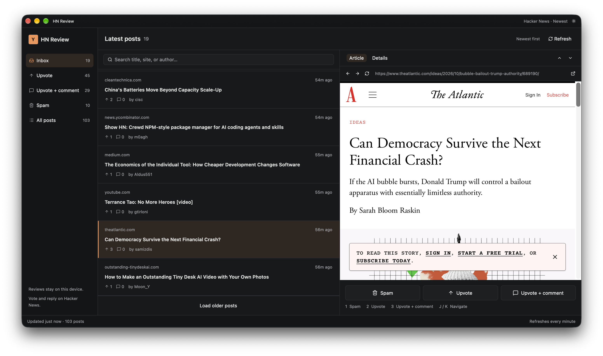

# RUIE



A native desktop inbox for reviewing new Hacker News posts, built with Rust,
GPUI Kit, and Wry. The application opens as **HN Review**; the Cargo package and
binary are named `ruie-studio`.

## What it does

- Fetches the newest posts in batches of 50 and refreshes every minute.
- Organizes posts into Inbox, Upvote, Upvote + comment, Spam, and All posts.
- Searches by title, site, or author.
- Displays articles in an embedded browser with back, forward, reload, and an
  option to open the page in your default browser.
- Shows post details and up to 20 top-level comments.
- Saves review decisions and comment drafts locally, with undo for reviews.
- Supports light and dark appearances and compact window layouts.

Review labels are local queues. Marking a post as Spam does not flag it on HN,
and selecting Upvote does not cast a vote. Use **Open on HN** to vote or reply.
For comment drafts, **Copy & open HN** copies the draft and opens the discussion
so you can paste and submit it yourself. No API key is required.

## Build and run

Install Rust and Cargo with support for the Rust 2024 edition, along with the
native build dependencies for GPUI Kit and Wry. On macOS, install Xcode Command
Line Tools with `xcode-select --install`. See the GPUI Kit checkout's
`website/docs/installation.md` for platform requirements. Linux also needs GTK 3
and WebKitGTK 4.1 development libraries; the embedded browser requires X11 or
XWayland.

The project uses a local path dependency on `../gpui-kit/crates/kit`. Clone both
repositories into the same parent directory:

```sh
git clone https://github.com/longbridge/gpui-kit.git
git clone https://github.com/andrewarrow/ruie.git
cd ruie
cargo run --locked
```

Expected layout:

```text
parent/
├── gpui-kit/
│   └── crates/kit/
└── ruie/
```

To build a release binary:

```sh
cargo build --release --locked
./target/release/ruie-studio
```

An internet connection is needed to fetch posts, comments, and article pages.
Previously saved posts and reviews are loaded on startup.

## Reviewing posts

Select a post to read its article. Use the review controls or right-click a row
to move it into a queue. Open **Details** for post text, comments, and external
links. Posts in **Upvote + comment** also have a locally saved comment editor
in Details. Reviewed posts can be moved back to Inbox or restored with Undo.

### Keyboard shortcuts

These review shortcuts apply when the workspace has focus, outside the search
field, draft editor, and embedded browser.

| Key | Action |
| --- | --- |
| `1` | Mark as Spam |
| `2` | Queue for Upvote |
| `3` | Queue for Upvote + comment |
| `J` / `↓` | Select the next post |
| `K` / `↑` | Select the previous post |
| `R` | Refresh posts |
| `/` | Focus search |
| `Esc` | Return to the post list in compact layouts |
| `Cmd+Z` on macOS | Undo the last review |

On macOS, `Cmd+Shift+T` toggles appearance and `Cmd+Q` quits the app. Appearance
and Undo also have buttons in the window.

## Local data

Cached posts, review decisions, comment drafts, and the last sync timestamp are
stored in `reviews.json`:

| Environment | Location |
| --- | --- |
| `XDG_DATA_HOME` is set | `$XDG_DATA_HOME/ruie-review/reviews.json` |
| macOS, otherwise | `~/Library/Application Support/ruie-review/reviews.json` |
| Other platforms, otherwise | `~/.local/share/ruie-review/reviews.json` |

The cache keeps reviewed posts, posts with drafts, and the newest 500 remaining
posts. Comments and undo history are held in memory for the current session.
Back up `reviews.json` to preserve your reviews and drafts.

## Development

Run the tests with the sibling GPUI Kit checkout available:

```sh
cargo test --locked
```

The suite covers queue filtering, persistence, URL validation, and context-menu
review actions at several window sizes.

The active application code lives in:

- `src/main.rs`: application startup, menu, and global shortcuts.
- `src/workspace.rs`: inbox, reader, review actions, and synchronization.
- `src/browser.rs`: embedded Wry browser and native window integration.
- `src/hn.rs`: public Hacker News API client and item types.
- `src/model.rs`: review queues, search, cache retention, and JSON storage.
- `src/theme.rs`: light and dark themes.

## License

[GNU General Public License v3.0](LICENSE).
